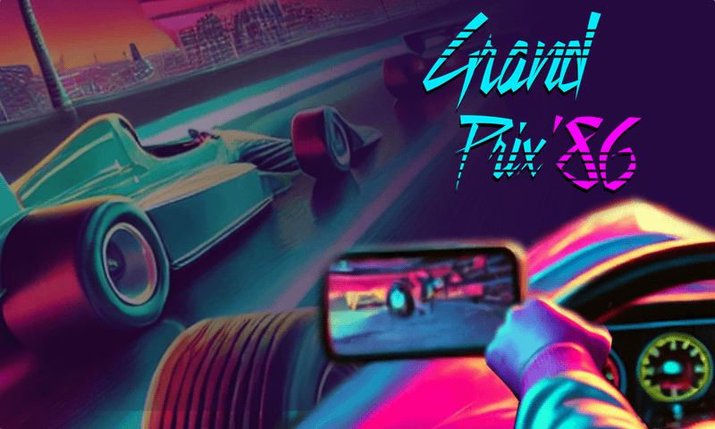
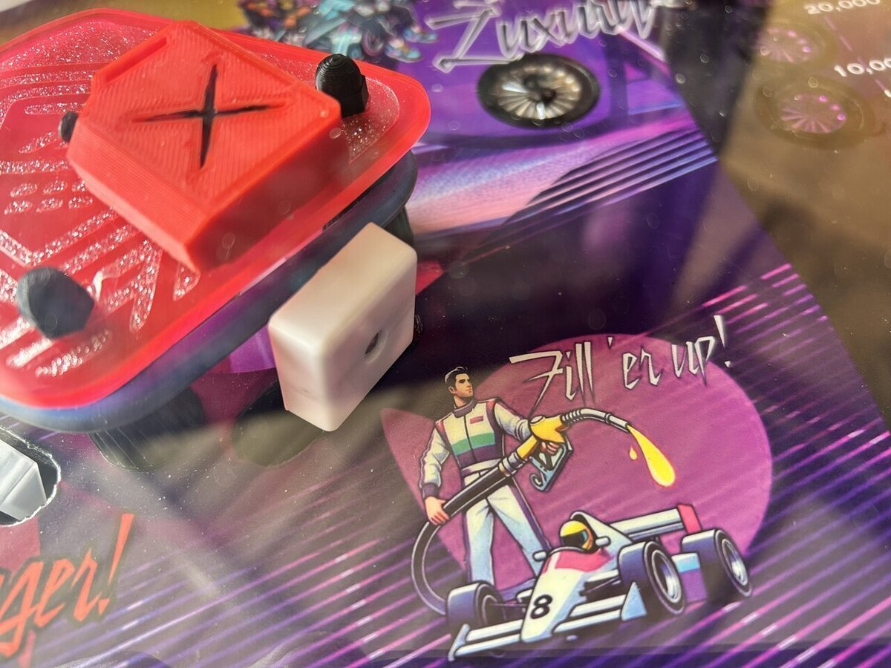
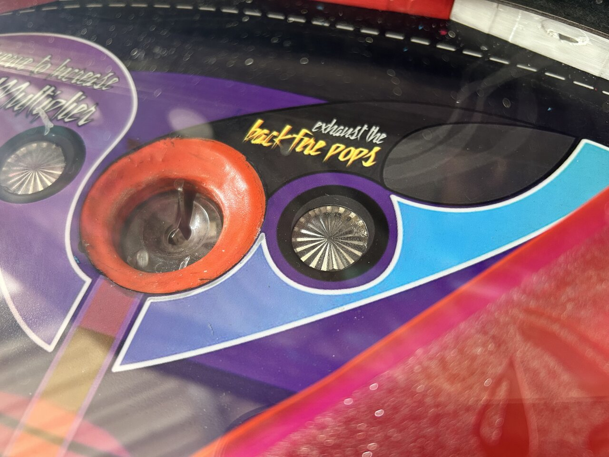
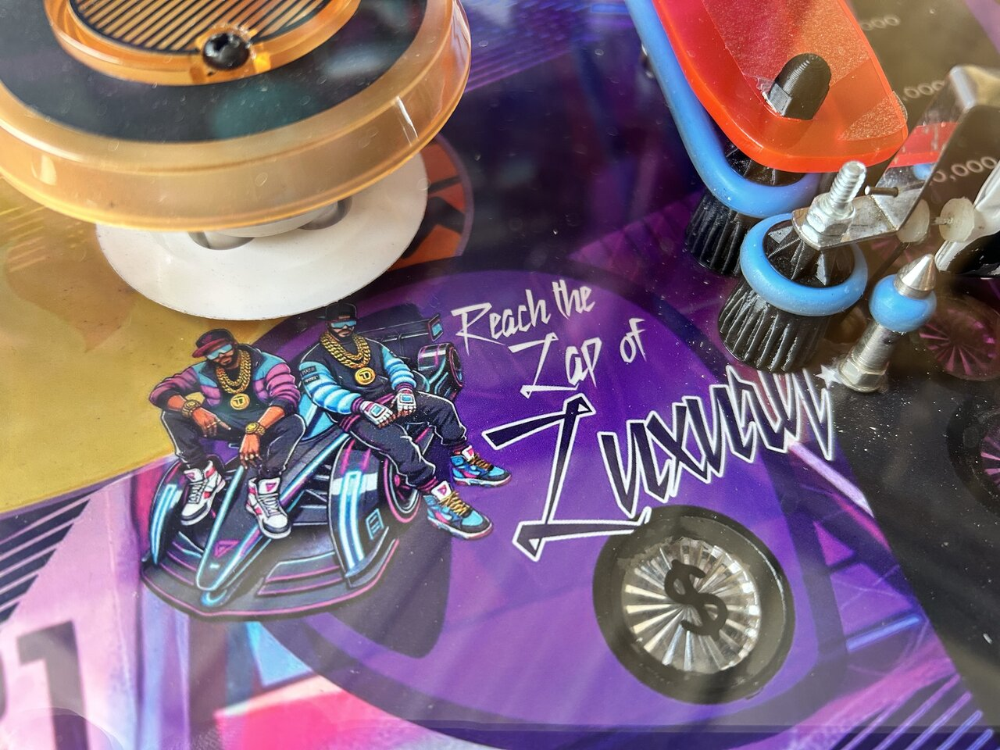
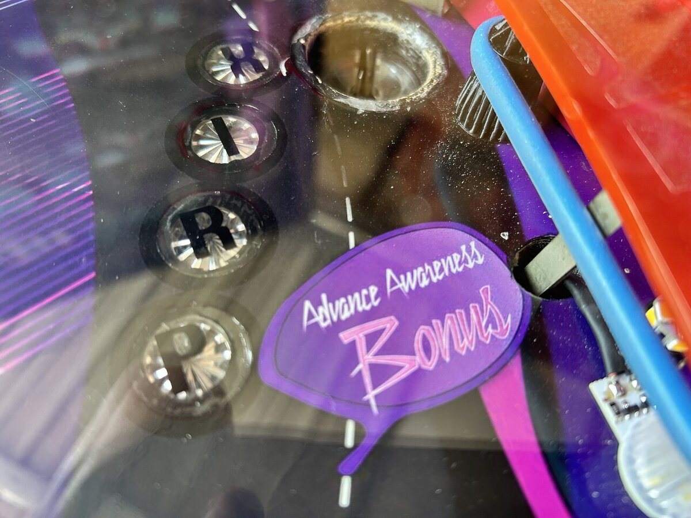
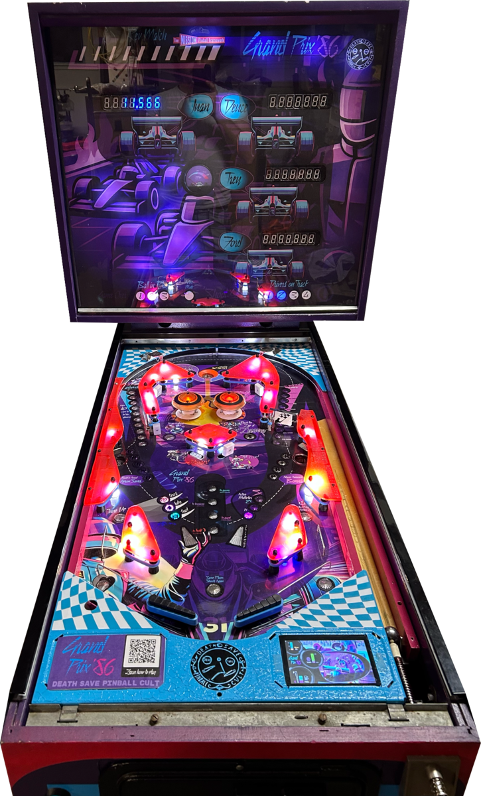

How to Play
===========

    Updated 11/23/26 by unrared.

Strap in for Grand Prix '86!
----------------------------

The homebrew pinball thrill ride where speed meets spaghetti code, and every multiball is a minor miracle!

**Your quest**: fuel up, fix up, and fly through laps in Green Flag Mode, where orbit shots rack up points and wear and tear sends you back to the pit. Smash your way through Backfire Pops for a frenzy of bumpers that skips the pit stop entirely. Craving more chaos? Play Grooveline, Lap of Luxury, and the gloriously glitchy Grand Prix multiballs—each one lighting up inserts like a disco ball with a loose wire. Play all three to unlock the Red Line Wizard Mode: three balls, a tach in the backbox, and five gears to shift through on the way to the checkered flag. And keep an eye out for Pure Evil.

How things are supposed to Work
-------------------------------

A day before the 2025 Pacific Northwest Pinball & Arcade Show, this game was not even flipping. Many burned up components and a hell of a lot of elbow grease later, well there's still much to do ...but she's flipping! If you've got ideas, share them with Death Save Pinball Cult.

### General

Out of the gate, try to get into the Backfire Hole with a skillful plunge. This will immediately drop the Green Flag. Otherwise, **your adventure begins in the pit**. But don't fret, your ride is almost ready to roll. You only need to fill up the tank (hit the Fuel target) to join the pack.

**Tune Up:** roll through the left inlane while you're in the pit to top up a random low resource (fuel, lube or tires). If that was the last one, you're racing.

**Outlane Save:** completing GRAND lights the heart on the driver's chest. While it's lit, the next ball down either outlane kicks out another ball, and you keep playing. It stays lit across balls until it's used, and completing GRAND again relights it.

#### Skill Shots

**Backfire Skill Shot** (Ball 1 launch)

Plunge directly into the Backfire Hole on your first launch:
- Awards 25,000 points
- All pit resources (fuel, lube, tires) are maxed out
- Green Flag mode starts immediately
- Lights a Luxury insert

**Off the Line** (Under a Green Flag)

When a ball begins under a Green Flag, a chime countdown keeps you honest (the display counts along: Get Ready, 3, 2, 1, Race!). Launch the ball out of the shooter lane right on the final ding (you get a split second either side) to pocket an extra 25,000 points (and a Luxury insert) with a shit-eating grin. Still sitting in the shooter lane when the window closes? You'll hear about being late.

#### Green-flag (Main Mode)

With a well-oiled vehicle, the race begins:

- Counter-clockwise orbit (the Grooveline switch) awards a lap: 5,000 points (× your multiplier)
- The switches score 50 to 2,500 points (× your multiplier), where the pit only gives 10
- 20 pop bumper hits will also get you around the track
- A successful lap advances your Grooveline insert progress
- The drop target costs you: hitting it wears out a random resource

Your car needs three things to "go": **fuel**, **lube**, and **tires**. Wear and tear is expected: every 3 laps, the race takes its toll:

- Usually one resource wears down, or sometimes all three
- About 1 in 5 times it's smooth sailing, and nothing wears
- Now and then, a multi-car wreck brings out the red flag (see Red Flag below)
- And very rarely, plain bad luck (a blowout, a seized engine or a fuel line) kills your flippers for the rest of the ball

When a resource runs low, it's back to the pit to top it up (the low ones flash).

The ball start has a 10 second ball save once you hit the playfield.

#### Backfire Pops

When returning to the pit, your engine may "backfire just right". After leaving Green Flag:

- You have 15 seconds to hit the Spinner, then enter the Backfire Hole
- Once activated, work the pop bumpers — scoring starts at 1,000 points and increases by 1,000 per hit (1k, 2k, 3k... up to 10k, × your multiplier)
- Collect 10 pop bumper hits to skip the pit stop and join the pack (and step up your multiplier)!

If you don't backfire, you'll need to ensure all three resources are filled
before getting back under green.

#### Red Flag

A multi-car wreck now and then brings out the red flag (not during a multiball). The race stops: scoring drops to the pit's, and topping up the pit (or Backfire) won't get you going again. The pit lights chase toward the Pot Hole and GRAND flashes: get in there to restart the race, or it's over for that ball.

#### End of Ball Bonus

At the end of each ball, the bonus is tallied on a results board and added to your score. Only what you've earned is shown:

- **Luxury**: 10,000 points per Luxury insert lit (see Lap of Luxury below)
- **Laps**: 1,000 points per lap
- **Multiballs**: 10,000 points for each multiball you've played
- **Super Jackpots**: 30,000 points for each multiball you've completed (its super jackpot, or Red Line's checkered flag)
- Hold both flippers to skip through it

No bonus is awarded if nothing was earned that ball.

#### Multiplier

The multiplier (1X, 2X, 5X) multiplies the playfield switches, laps and the regular jackpots (not the super jackpots). It lasts 30 seconds (or until you're back in the pit). At 2X, each lap counts twice toward Grooveline:

- Two quick laps (within 15 seconds) light 2X
- During any multiball, "Swerve" at apex of the loop 5 times for 2X
- Completing Backfire Pops steps it up (into Green Flag)
- Every super jackpot (Grand Prix's, Lap of Luxury's, Red Line's Checkered Flag) steps it up (1X to 2X, 2X to 5X)
- Grooveline's super jackpot steps it up until the multiball ends

### Extra Ball

Light PRIX, then show some awareness: hit the right standing target 4 more times *without* falling into the Oil Slick beside it. That lights the extra ball; roll through the right inlane to collect it.

### Replay

Beat the replay score for a **free game** (or an **extra ball** on free play), once a game. Beat it and the next replay score is 1.5x your final score; 50 games without one and it's halved.

### Match

At the end of the game, the backbox lamps and the score displays spin for a match. If the last two digits of your score match, it's a **free game** (in credit play), and your score blinks.

### Special Modes

Three special modes build up to the activation of a fourth, wizard mode.

#### Grooveline Multiball 1/3

The fastest way around the track (the North-West chain of 10 purple inserts).

- Making a lap during Green Flag lights an insert, in sequence from top to bottom
- Progress persists across balls and through pit stops within a ball
- Light all 10 inserts to qualify the multiball
- Hit the multiball target to activate Grooveline Multiball

- A 2 ball multiball, with 10 seconds of ball save
- Playing it (once it ends) marks it done and advances Red Line progress

During the multiball, shoot the blinking shots on the left: the Grooveline
lane, the multiball target, and the Pot Hole or the target below it.

- Each hit lights the next Grooveline insert, from the bottom up
- Each hit is a **Jackpot**, worth 5,000 more every time (30,000 up to
  70,000, × your multiplier)
- The 10th hit lights them all for the **Super Jackpot** (250,000) instead! It also
  bumps your multiplier (1X to 2X, or 2X to 5X) until the multiball ends

#### Lap of Luxury Multiball 2/3

Race in style during Green Flag across multiple balls to max out the bonus, lighting all inserts in the North-East chain and qualifying the "Lap of Luxury".

Each Luxury step lights an insert (worth 10,000 in the end of ball bonus). Steps come from:

- Every 8 Spinner hits during Green Flag. Swerve hits count as Spinner hits too
- With the multiplier, each Spinner or Swerve hit counts that many times (2X counts double)
- Every lap
- The Backfire Skill Shot and Off the Line
- Completing Backfire Pops (getting back under green)

- Progress accumulates across all balls (it never resets)
- North-East bonus inserts show your progress
- Light all 10 Luxury inserts to qualify
- Hit the multiball target to begin Luxury Multiball (2 balls, with 10 seconds of ball save)
  - Each blinking insert collected is a **Jackpot** (75,000, × your multiplier)
  - Collecting the 6th is the **Super Jackpot** (300,000) instead
  - The pop bumpers pay 500 (× your multiplier), unless Backfire Pops is running
- Playing it (once it ends) marks it done and advances Red Line progress

#### Grand Prix Multiball 3/3

It's the name of the game!

- Top-most 5 inserts in South-West chain spells out G-R-A-N-D
- Top-most 4 inserts in South-East chain spells out P-R-I-X
- Left standing target lights a GRAND insert (5 hits to complete). Completing GRAND also lights the Outlane Save
- After lighting all of GRAND, entering the Pot Hole:
  - Locks a ball
  - Enables PRIX
- Right standing target lights a PRIX insert (4 hits to complete)
- After lighting all 4 of PRIX, entering the Oil Slick:
  - Locks a second ball
  - Lights the multiball
- Enter the **Backfire Hole** to release both locks and start Grand Prix Multiball (3 balls, with 20 seconds of ball save)
- Playing it (once it ends) marks it done and advances Red Line progress
- The mode can be qualified and played again after completion

During the multiball, GRAND chases down and PRIX chases up while the swerve
lights alternate. Get back into the 3 holes that started the race (the Pot Hole, the Oil
Slick and the Backfire Hole):

- Each hole holds the ball and its lights stay on (GRAND for the Pot Hole, PRIX
  for the Oil Slick, the swerve lights for the Backfire Hole) for as long as it's there
- Every hole entered restarts a single **30 second** timer. Get into another
  hole before it runs out or the last ball held is kicked back out (then the
  timer restarts for any still held)
- Each new hole filled is a **Jackpot** (100,000, × your multiplier), up to 2 per sequence. Losing
  a hole and refilling it doesn't pay that jackpot again
- Fill all 3 for the **Super Jackpot** (500,000) instead! All 3 balls are released and
  the sequence starts over
- Draining a ball empties all the holes
- Every lap is a **Leader Bonus**: 20,000, then 40,000, 60,000... up to 100,000 a lap

#### Red Line (Wizard Mode)

Play all three special modes — Grooveline, Lap of Luxury, and Grand Prix — to qualify Red Line (the multiball lamp blinks). Enter any hole (the Pot Hole, the Oil Slick, or the Backfire Hole) to start the wizard mode: a 3 ball multiball with a full minute of ball save.

After Red Line, play Grooveline and Grand Prix again to get back to it (Lap of Luxury stays done). Pure Evil can't show up during Red Line.

- **Rev it up:** every switch revs the engine, lighting the next Rev Match light in the backbox (the tach). It drains a light every 10 seconds
- **At the red line** (all 10 lit) the engine bounces off the limiter and the tach stays full until you shift. Until then, everything but the Backfire Hole scores like the pit (10 points, just the bell)
- **Shift** in the Backfire Hole, whenever you get there, for a backfire and a **Jackpot** (250,000 × your gear, × your multiplier), then rev up again in the next gear (the signal lights show it)
- **5th gear:** hit the Grooveline lane, the Pot Hole and the Oil Slick (blinking) for the **Checkered Flag** (2,000,000), then it's back to 1st gear for another race
- **Shift Champ:** the most shifts in a game gets its own high score, shown with the Laps Champ in attract

### Pure Evil

Beware the "Pure Evil" straight from James Cameron's nitemarish dreams. It shows up on a random lap:

- Every second costs you 1% of your score, for up to 40 seconds
- Hit the drop target to stop the bleeding

