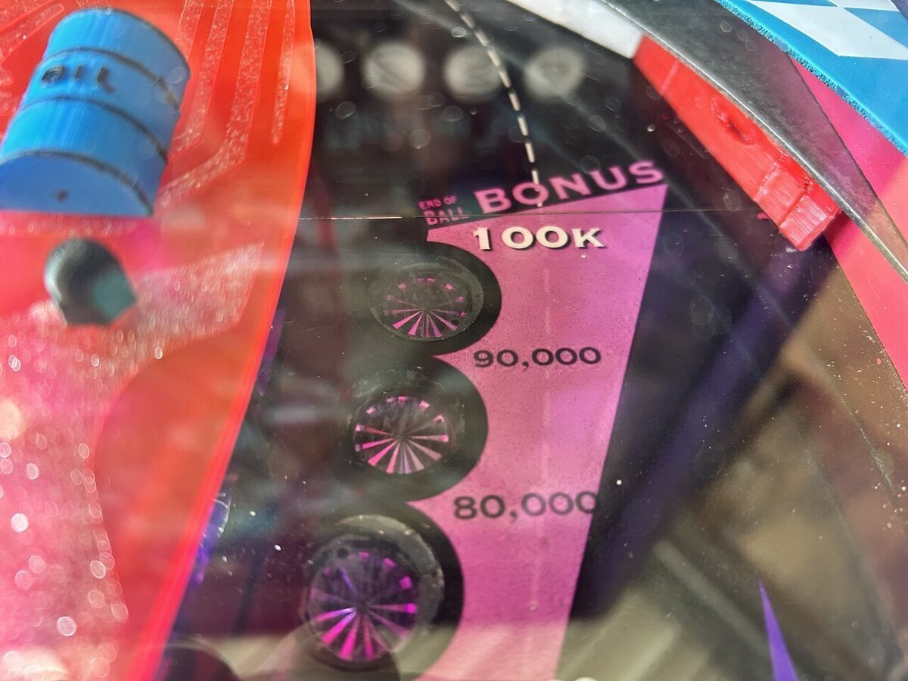
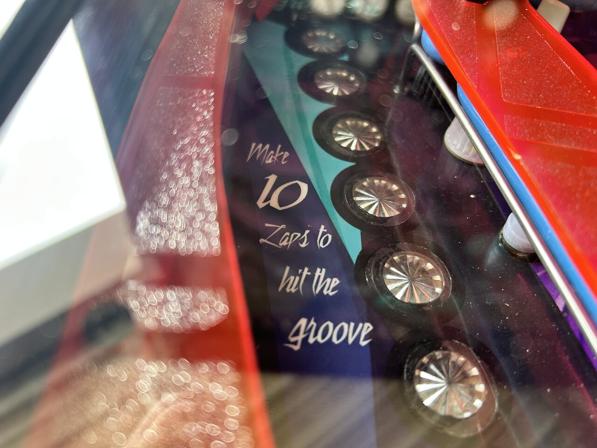
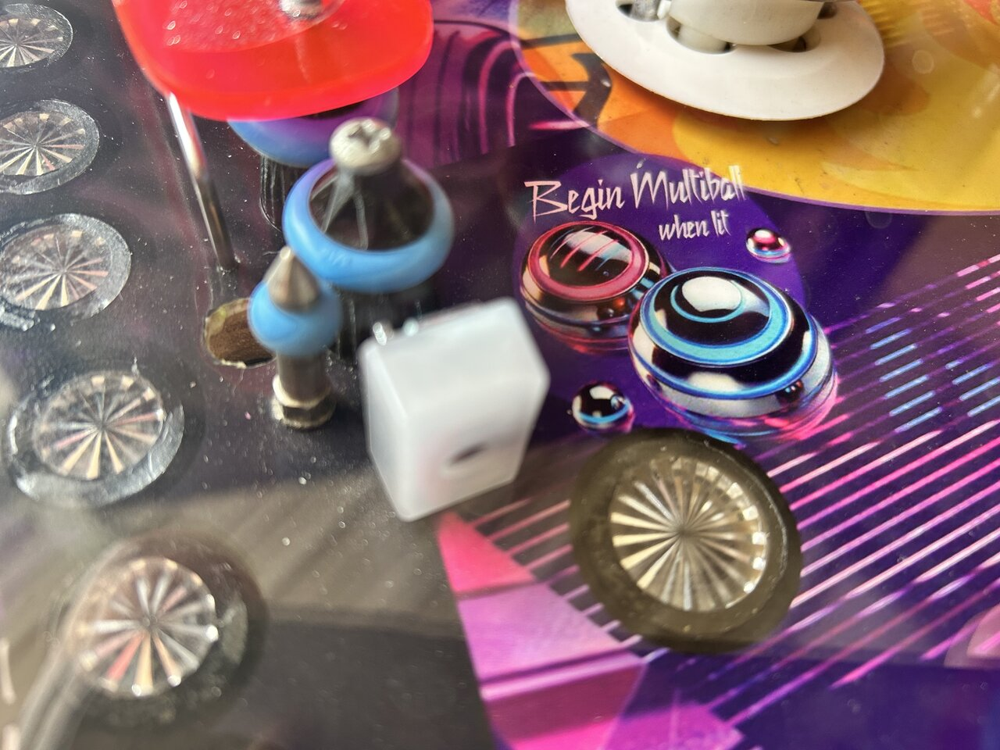
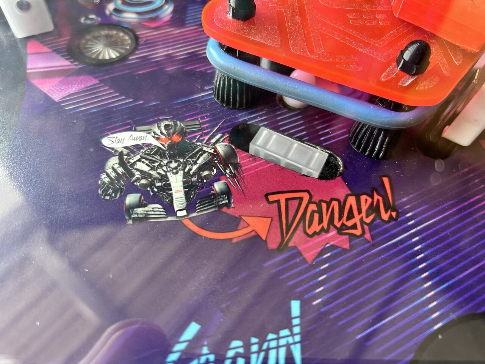

How to Play
===========

    Updated 5/23/26 by unrared.

Strap in for Grand Prix '86!
----------------------------

The homebrew pinball thrill ride where speed meets spaghetti code, and every multiball is a minor miracle!

**Your quest**: fuel up, fix up, and fly through laps in Green Flag Mode, where orbit shots rack up points and sometimes even do other things yet to be determined. Smash your way through Backfire Pops for a frenzy of bumpers and "hurry ups" that may or may not hurry anything. Craving more chaos? Unlock Grooveline, Lap of Luxury, or the gloriously glitchy Grand Prix multiballs—each one lighting up inserts like a disco ball with a loose wire. Complete all three to trigger the legendary Red Line Wizard Mode, a ball-slinging spectacle that will leave you wondering what you're actually supposed to do here because we haven't written that code yet, but imagine how amazing it will be when or if we ever get around to doing so!

How things are supposed to Work
-------------------------------

A day before the 2025 Pacific Northwest Pinball & Arcade Show, this game was not even flipping. Many burned up components and a hell of a lot of elbow grease later, well there's still much to do ...but she's flipping! If you've got ideas, share them with Death Save Pinball Cult.

### General

Out of the gate, try to get into the Backfire Hole with a skillful plunge. This will immediately drop the Green Flag. Otherwise, **your adventure begins in the pit**. But don't fret, your ride is almost ready to roll. You only need to fill up the tank (hit the Fuel target) to join the pack.

#### Skill Shots

**Backfire Skill Shot** (Ball 1 launch)

Plunge directly into the Backfire Hole on your first launch:
- Awards 25,000 points
- All pit resources (fuel, lube, tires) are maxed out
- Green Flag mode starts immediately
- Lights a Luxury insert

**Off the Line** (Under a Green Flag)

When a ball begins under a Green Flag, a chime countdown keeps you honest.  Launch the ball out of the shooter lane right on the final ding (you get a split second either side) to pocket an extra 5,000 points (and a Luxury insert) with a shit-eating grin. Still sitting in the shooter lane when the window closes? You'll hear about being late.

#### Green-flag (Main Mode)

With a well-oiled vehicle, the race begins:

- Counter-clockwise orbit (the Grooveline switch) awards a lap and 100 points
- 10 pop bumper hits will also get you around the track
- A successful lap advances your Grooveline insert progress

Your car needs three things to "go": **fuel**, **lube**, and **tires**. Wear and tear is expected, so before long you'll find yourself back in the pit.

#### Backfire Pops

When returning to the pit, your engine may "backfire just right". After leaving Green Flag:

- You have 10 seconds to hit the Spinner, then enter the Backfire Hole
- Once activated, work the pop bumpers — scoring starts at 1,000 points and increases by 1,000 per hit (1k, 2k, 3k... up to 10k)
- Collect 10 pop bumper hits to have a smooth pit and join the pack!

If you don't backfire, you'll need to ensure all three resources are filled
before getting back under green.

#### End of Ball Bonus

At the end of each ball, bonus is tallied and added to your score:

- **Spinner Bonus**: 10,000 points per Luxury counter step accumulated (see Lap of Luxury below)
- **Lap Bonus**: 1,000 points per lap completed during the ball
- Both bonuses are multiplied by your current multiplier

No bonus is awarded if nothing was earned that ball.

#### Multiplier

During any multiball, "Swerve" at apex of the loop to increment your multiplier.

### Special Modes

Three special modes build up to the activation of a fourth, wizard mode.

#### Grooveline Multiball 1/3

The fastest way around the track (the North-West chain of 10 purple inserts).

- Making a lap during Green Flag lights an insert, in sequence from top to bottom
- Progress persists across balls and through pit stops within a ball
- Light all 10 inserts to qualify the multiball
- Hit the multiball target to activate Grooveline Multiball

- Activating the mode advances Red Line progress

During the multiball, shoot the blinking shots on the left: the Grooveline
lane, the multiball target, and the Grand Hole or the target below it.

- Each hit lights the next Grooveline insert, from the bottom up
- Each hit is a **Jackpot**, worth 10,000 more every time (50,000 up to
  130,000)
- The 10th hit lights them all for the **Super Jackpot** (500,000) instead! It also
  bumps your multiplier (1X to 2X, or 2X to 5X) until the multiball ends

#### Lap of Luxury Multiball 2/3

Race in style during Green Flag across multiple balls to max out the bonus, lighting all inserts in the North-East chain and qualifying the "Lap of Luxury".

Each Luxury step lights an insert (worth 10,000 in the end of ball bonus). Steps come from:

- Every 8 Spinner hits during Green Flag. Swerve hits count as Spinner hits too
- With the multiplier, each Spinner or Swerve hit counts that many times (2X counts double)
- Every lap
- The Backfire Skill Shot and Off the Line
- Completing Backfire Pops (getting back under green)

- Progress accumulates across all balls (it never resets)
- North-East bonus inserts show your progress
- Light all 10 Luxury inserts to qualify
- Hit the multiball target to begin Luxury Multiball
  - Each blinking insert collected is a **Jackpot** (25,000)
  - Collecting the 6th is the **Super Jackpot** (250,000) instead
- Completing the mode marks it done and advances Red Line progress

#### Grand Prix Multiball 3/3

It's the name of the game!

- Top-most 5 inserts in South-West chain spells out G-R-A-N-D
- Top-most 4 inserts in South-East chain spells out P-R-I-X
- Left standing target lights a GRAND insert (5 hits to complete)
- After lighting all of GRAND, entering the Grand Hole:
  - Locks a ball
  - Enables PRIX
- Right standing target lights a PRIX insert (4 hits to complete)
- After lighting all 4 of PRIX, entering the Prix Hole:
  - Locks a second ball
  - Lights the multiball
- Enter the **Backfire Hole** to release both locks and start Grand Prix Multiball
- Completing the mode marks it done and advances Red Line progress
- The mode can be qualified and played again after completion

During the multiball, GRAND chases down and PRIX chases up while the swerve
lights alternate. Get back into the 3 holes that started the race (Grand, Prix
and Backfire):

- Each hole holds the ball and its lights stay on (GRAND, PRIX or the swerve
  lights for the Backfire Hole) for as long as it's there
- Every hole entered restarts a single **30 second** timer. Get into another
  hole before it runs out or the last ball held is kicked back out (then the
  timer restarts for any still held)
- Each new hole filled is a **Jackpot** (100,000), up to 2 per sequence. Losing
  a hole and refilling it doesn't pay that jackpot again
- Fill all 3 for the **Super Jackpot** (500,000) instead! All 3 balls are released and
  the sequence starts over
- Draining a ball empties all the holes

#### Red Line (Wizard Mode)

Complete all three special modes — Grooveline, Lap of Luxury, and Grand Prix — to qualify Red Line. Enter any hole (Grand, Prix, or Backfire) to start the mode and find out how deep the rabbit hole goes, which right now is nowhere, but you can pat yourself on the back for having come this far!

### Pure Evil

Beware the "Pure Evil" straight from James Cameron's nitemarish dreams:

- Every second costs you
- Hit the drop target to stop the bleeding

