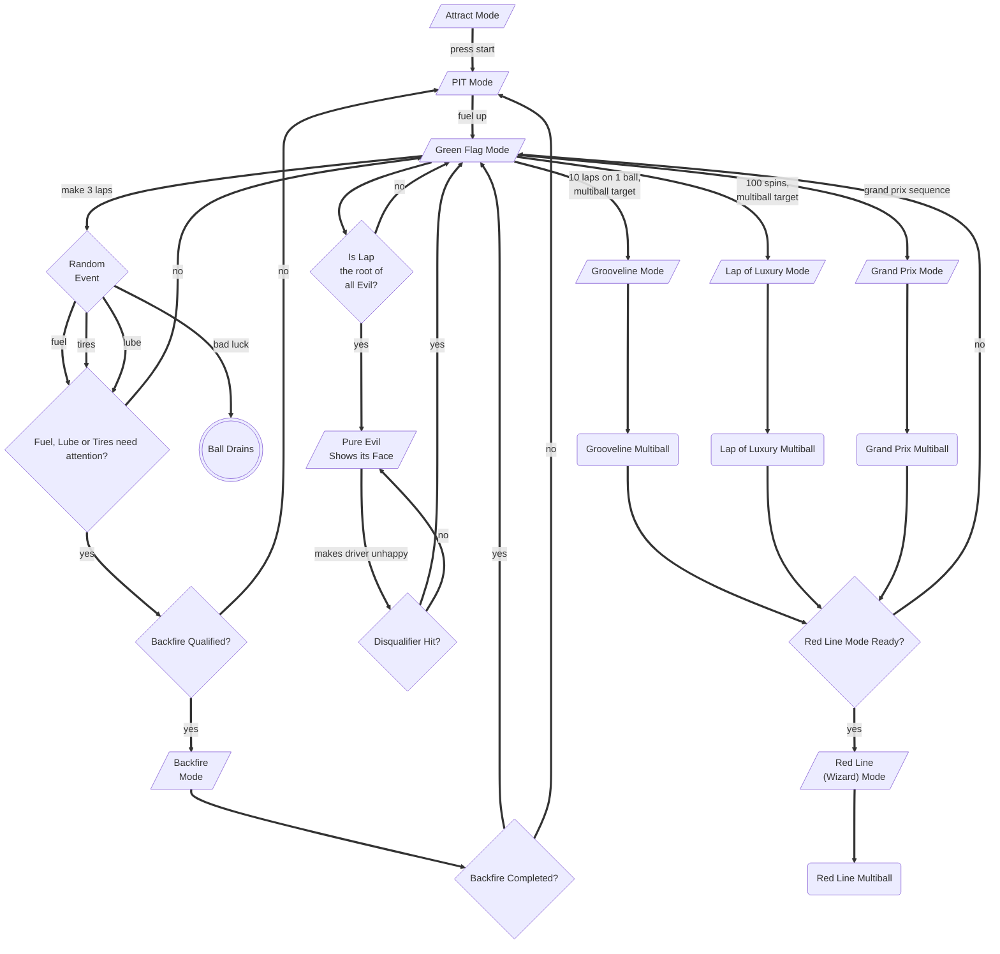

Overview
========

Running the Game
----------------

- **Development** - `bin/dev` will run both `mpf` and `mpf-mc`
  without the console GUI. It will also run `mpf monitor` so you can
  interact with it.
- **Production** - `bin/run` will run for production using the real
  hardware devices and the console GUI.
- **Test** - Run a test with `bin/test tests/test_something.py` or
  simply `bin/test` to run all tests from the `./tests` folder.

Synthesis Call outs
-------------------

The synth call outs are made from text with `bin/voice-callout`. Every one
is listed in `./misc/voice-callouts.yaml` (the voice to use, then each file
name and what's said). It says each with macOS `say`, compresses and
bit-crushes it (an approximation of the "Tritik Krush" VST the originals were
made with), EQs and loudness matches it to the original call outs, then gives
it the same saturation, crush and de-esser as the rest of the voice audio.

- Rebuild all of them: `bin/voice-callout`
- Rebuild some (and hear them): `bin/voice-callout jackpot tilt1 --play`
- Add a new one (also added to `./config/common/sounds.yaml`):
  `bin/voice-callout add grand-prix-position-lost "Lost position!"`
- Try another voice: `bin/voice-callout jackpot --voice Ralph --play`

Then play it from a `sound_player` by its sound name (the file name with
underscores, e.g. `grand_prix_position_lost`). To change a call out (or the
voice for all of them), edit `./misc/voice-callouts.yaml` and re-run.

The rest of the voice audio (Steve, and the synth `bonus3` which has custom
audio mixed in) is lightly distorted, bit-crushed and de-essed by
`bin/voice-crush`, working from untouched copies in `./misc/voice-originals`
so it can be re-run with new settings (`bin/voice-crush --help`).

Attract Light Show
------------------

`./shows/attract.yaml` is generated by `bin/attract-lights` (don't edit it by
hand). It computes every light 20 times a second from effects that use each
light's position in the MPF monitor (`./monitor/monitor.yaml`, with
`./misc/light-layout.yaml` saying where the playfield and backbox are in its
image and placing the few lights it doesn't), so sweeps, shockwaves and waves
travel across the playfield and up into the backbox. Only the RGB
LEDs (`./config/common/rgb_leds.yaml`) are multicolor, in a synthwave palette
(the backbox player up LEDs only white, cyan or blue); every other light is
on/off. About a minute, looped: start lights, the race (with the Rev Match bar
as a tach), sweeps, shockwaves, a checkered flag, plasma, a pit stop strobe
and a finale.

Change an act (in `bin/attract-lights`) or move lights in the monitor, then
run `bin/attract-lights`.

Flowchart
---------

This is a rough idea of how things work together.

