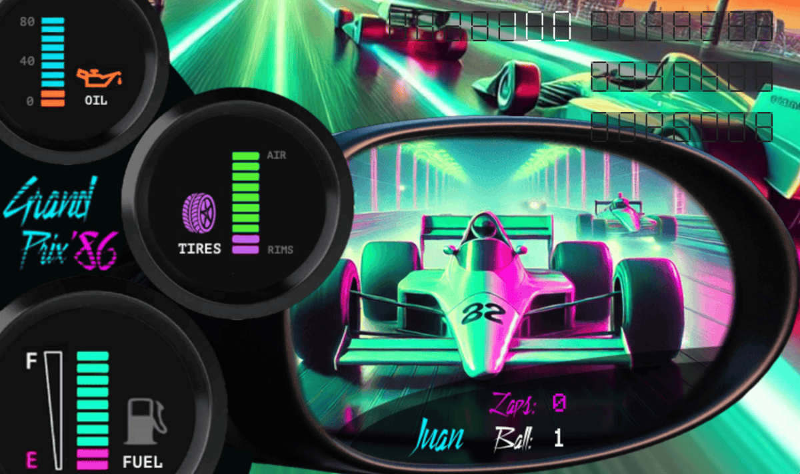

Green Flag Mode
===============

    Updated 5/23/26 by unrared.

This is the primary mode.

Activation
----------

1. On ball launch, hitting the `skill_backfire` skill shot from `./modes/pit/config/shots.yaml`.
1. During the `pit` mode, hitting 1 of the 3 (`s_pit_fuel`, `s_pit_lube`,
   `s_pit_tires`) switches when the other 2 are already full.
1. During the `backfire` mode per the `logicblock_backfire_counter_complete`
   event.
1. Immediately on `ball_started` for ball 2 if not having activated, yet.

Making Laps
-----------

1. Hitting the `s_spinner` activates the `loop_gate` in `./config/common/diverters.yaml` which opens the gate for 2 seconds.
1. The ball continues its travel from the top of the playfield to the left lane where it will roll over the `s_grooveline`.
1. The `seq_lap` sequence in `./modes/green_flag/config/sequences.yaml` is completed.
1. `logicblock_seq_lap_complete` adds 1 to the `lap_count` player variable.

Shows
-----

- Hitting the `s_spinner` plays the 3 chimes in sequence (1, 2, 3, 1, 2, 3,
  1). On completing a `spin_counter` step (8 counts), all 3 chimes sound
  together and pulse the shaker motor. This syncs with the current value of
  `spin_counter_count` (with the multiplier or swerve hits counting too, some
  chimes are skipped).

Wear and Tear
-------------

Every 3rd lap, `./modes/green_flag/config/random_event_player.yaml` picks a
random event (when the `WEAR_AND_TEAR` feature is available, the default):

- 20% each lose a level of fuel, lube or tires, 14% all three
- 20% `green_flag_smooth_sailing`: nothing happens, but a callout says things
  are going well (the `smooth_sailing` pool)
- 5% `green_flag_under_red` (not done yet)
- 1% **bad luck** (`green_flag_bad_luck`): green flag ends and the flippers
  go dead, so the ball drains and ends. One of `bad_luck_blow_out`,
  `bad_luck_seized_up` or `bad_luck_fuel_line` is picked, which plays its
  callout pool, and every RGB insert goes solid red until the ball drains
  (both in `./modes/pit/config`, as green flag has already stopped).

Off the Line Countdown
----------------------

Each time `green_flag` starts, `./shows/under_green.yaml` plays the chimes and
signal lights. Its 3 chimes post `off_the_line_countdown3`, `2` and `1`, and
the final ding posts `green_flag_dropped`. `./modes/green_flag/config/widget_player.yaml`
shows a pulsing "Get Ready" from the moment `green_flag` starts (its event
player posts `off_the_line_get_ready`, as the show waits for its sync first),
then a big "3" (red), "2" (orange) and "1" (yellow) over the slide (dimmed),
then "Race!" over the green flag image on lime at 60% (like the jackpots) (`countdown3` etc. in `./config/common/widgets.yaml`), each
fading out and replaced by the next. The Off the Line window (Pit mode
`off_the_line` timer) is centered on the final ding.
