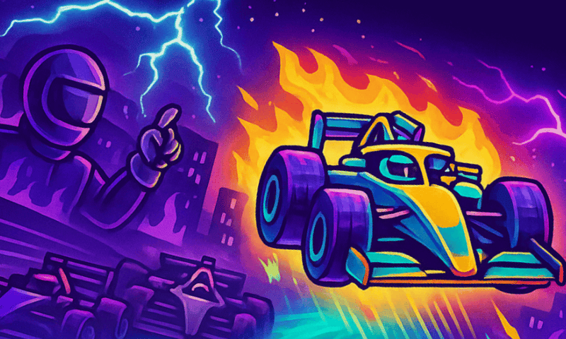
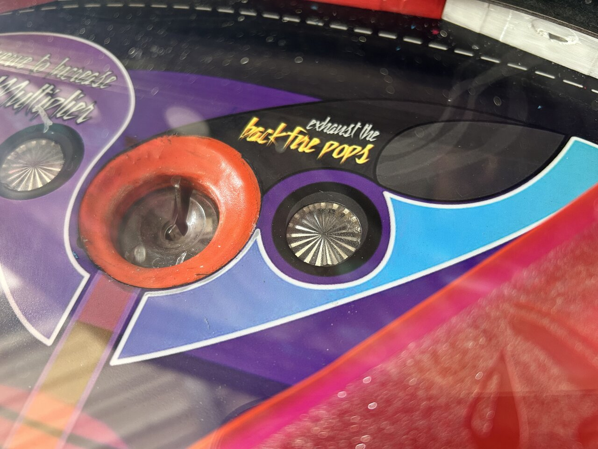

Grand Prix Multiball
====================

    Updated 11/21/26 by unrared.

Grand Prix is primarily controlled by the mid-playfield, left and right-side
targets and kick-out holes.

Activation
----------

### 1. G-R-A-N-D Lock

1. During `green_flag`, hit the **Apron Saves** target `s_save_target` to build up
   the `grand_counter`.
1. With "G R A N D" lit, the `grand_hole` multiball lock is enabled per the
   `logicblock_grand_counter_complete` event.
1. Entering the `grand_hole` locks the ball there.

### 2. P-R-I-X Lock

1. Mirroring "G-R-A-N-D", the **Advance Awareness Bonus** target `s_bonus_target`
increments the `prix_counter`.
1. With "P R I X" lit, the `prix_hole` multiball lock is enabled per the
   `logicblock_prix_counter_complete` event.
1. Entering the `prix_hole` locks the ball there.

### 3. Backfire Lock

Unlike the other multiball modes, Grand Prix Multiball begins with the
`balldevice_bd_backfire_hole_ball_entered` event in
`modes/pit/config/event_player.yaml` conditionally firing
`grand_prix_multiball_ready` based on the state of both the counters and
locks described above.

Shots
-----

Get back into the 3 holes used to start the multiball: the `grand_hole`,
`prix_hole` and `backfire_hole`. All 3 are held by the `grand_prix_holes`
ball hold (`./modes/grand_prix/config/ball_holds.yaml`) and run by
`./modes/grand_prix/code/grand_prix.py`.

1. Every ball held (re)starts a single **30s hurry up** shared by all 3 holes.
   If it runs out, ONE ball is ejected (the most recently held), the
   "Lost position!" call out plays (`grand_prix_hole_lost` ->
   `grand_prix_position_lost`) and the hurry up restarts for any balls still
   held.
1. A **Jackpot** (100,000) is awarded each time the number of held balls
   reaches a new high for the sequence, so up to 3 per sequence. Going from 2
   held to 1 and back to 2 does NOT pay the 2nd jackpot again.
1. Holding all 3 awards the **Super Jackpot** (500,000), ejects all 3 balls
   and restarts the sequence.
1. A drain ejects every held ball (jackpots already awarded in the sequence
   stay awarded).

Scores are in `./modes/grand_prix/config/variable_player.yaml`.

The holes confirm an eject after 2s (`eject_timeouts` in
`./config/common/ball_devices.yaml`). Before that, a ball getting back into
the hole is treated as a failed eject (kicked out again, not held).

Lights
------

While the multiball runs (`./modes/grand_prix/config/show_player.yaml`):

- `tag_lights_grand` chases 5 to 1 (`./shows/grand_prix_grand_chase.yaml`)
- `tag_lights_prix` chases 1 to 4 (`./shows/grand_prix_prix_chase.yaml`)
- `l_swerve1` and `l_swerve2` alternate (`./shows/grand_prix_swerve.yaml`)

Each chase lights one insert at a time (staying on), then turns them all off
and repeats.

While a hole holds a ball, its area's lights stay on over the shows (`GRAND`
for the `grand_hole`, `PRIX` for the `prix_hole` and the swerve lights for the
`backfire_hole`) until the ball is ejected, per `update_lights` in the mode
code.
