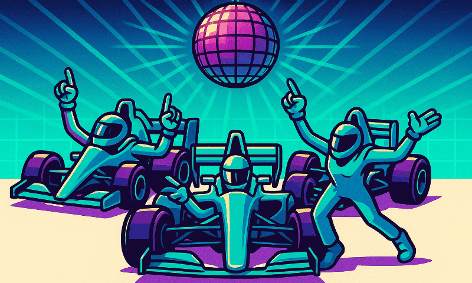
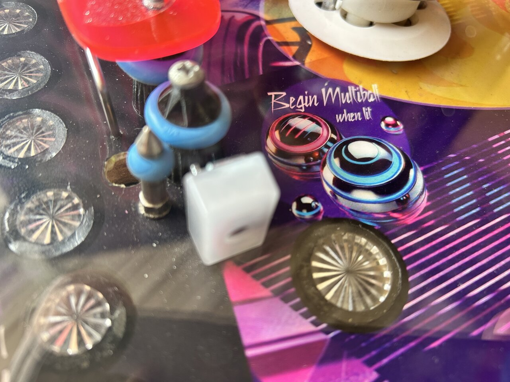

Grooveline Multiball
====================

    Updated 5/24/26 by unrared.

Grooveline is a 2 ball multiball built up by making laps and hitting pop
bumpers.

Activation
----------

There are two ways to increment the
`lap_counter` in `./modes/green_flag/config/counters.yaml`:

- Making a lap during `green_flag` per the `logicblock_seq_lap_complete` event.
- Hitting 20 pop bumpers per `logicblock_rubbing_is_racing_counter_complete`.

Doing either increments the `grooveline_counter`. After 10 hits, the
Grooveline inserts will trace indicating multiball is ready and hitting the
`s_target_multiball` begins the mode.

Shots
-----

The shots are on the left side of the playfield, handled by
`./modes/grooveline/code/grooveline.py`. Their lamps blink: the top
Grooveline insert (`l_grooveline01`), the multiball lamp (`l_multiball`) and
the top Grand insert (`l_grand1`).

- `s_grooveline` (the Grooveline lane)
- `s_target_multiball` (the hit that starts the mode doesn't count)
- `s_hole_grand` or `s_target_save` (the Grand area)

Every hit on any of them:

- Lights the next Grooveline insert, from the bottom (`l_grooveline10`) up
- Pays a **Jackpot** (`grooveline_jackpot`) that grows with each hit: 50,000,
  60,000, ... up to 140,000 for the 10th

The 10th hit lights the top insert and also pays the **Super Jackpot**
(500,000, `grooveline_super_jackpot`). That completes the shots, so the lamps
stop blinking and the inserts stay lit. It also bumps the multiplier (1X to
2X, or 2X to 5X) for the rest of the multiball: the player's
`is_grooveline_boosted` stops the 30s `multiplier` timer
(`./modes/pit/config/timers.yaml`) and keeps a pit stop from resetting it, and
it goes back to 1X when the mode ends. The jackpots aren't multiplied, like
Grand Prix's.
