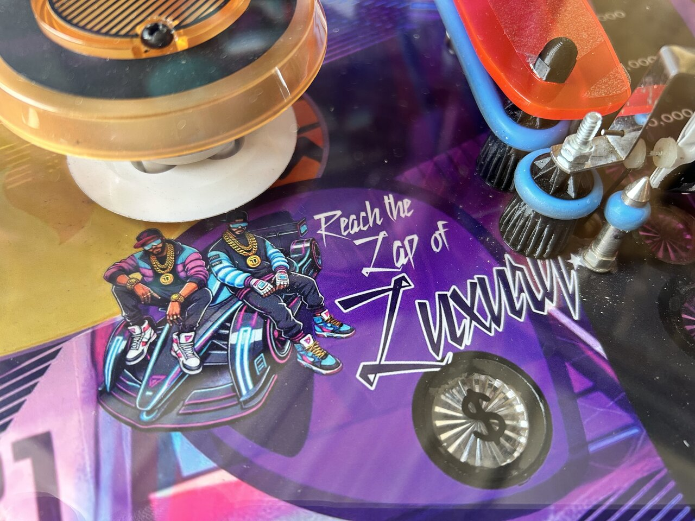
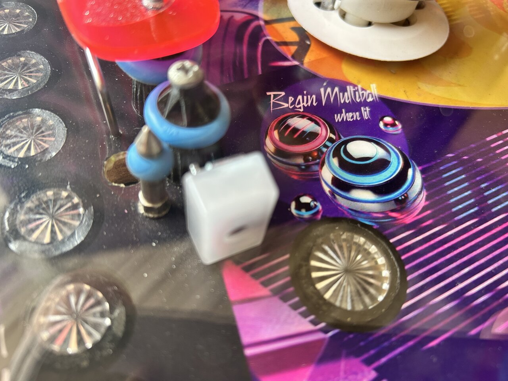

Lap of Luxury Multiball
=======================

    Updated 11/21/26 by unrared.

Lap of Luxury is driven by the `luxury_counter`, which persists across all
balls. Each step lights a Luxury/Bonus insert (worth 10,000 in the end of ball
bonus).

Activation
----------

The `luxury_counter` in `./modes/green_flag/config/counters.yaml` advances a
step on any of:

1. **Spins:** the `spin_counter` (same file) counts `s_spinner` and the
   `tag_swerve` switches during `green_flag` and is **completed at 8**,
   triggering `logicblock_spin_counter_complete`. With the `multiplier` above
   1, each hit counts `multiplier` times (via `control_events`). Counts past 8
   are not carried over to the next step.
1. **Laps:** every `logicblock_lap_counter_hit`.
1. **Off the Line:** `off_the_line_hit`.
1. **Skill shot and Backfire Pops:** `skill_backfire_hit` and
   `logicblock_backfire_counter_complete` both START `green_flag` (so the
   counter isn't running yet). `./modes/pit/config/variable_player.yaml` sets
   the `luxury_step_pending` player variable, and once `green_flag` has
   started, `./modes/pit/config/event_player.yaml` posts `luxury_step` to
   award it.

Once all 10 steps are lit (`logicblock_luxury_counter_complete`), the
`luxury_qualifier` sequence shot in
`./modes/green_flag/config/sequence_shots.yaml` comes into play. The multiball
insert will now flash and hitting the `s_target_multiball` begins the mode.

Shots
-----

Once activated, six areas of the playfield will blink inserts at:

- The bottom and top of the "P R I X" chain for `s_target_bonus` and `s_hole_prix`.
- The bottom of the "Bonus" chain (10,000) for `s_spinner`.
- The top of the "Grooveline" chain (top-left of playfield) for `s_grooveline`.
- The bottom and top of the "G R A N D" chain for `s_target_save` and `s_hole_grand`.

Hitting any of the individual switches is a **Jackpot** (`luxury_jackpot`)
awarding 25,000 points per `./modes/luxury/config/variable_player.yaml`.
Activating the last of the switches is only the **Super Jackpot**
(`luxury_complete`) awarding 250,000 points, and completes the mode
(`./modes/luxury/config/event_player.yaml` only posts `luxury_jackpot` while
the shot group isn't complete; its `luxury_complete` comes before the last
shot's hit). Then it posts `luxury_finished` 3.5s later
(so the callouts below can finish), which stops it and gameplay returns to
`green_flag`.

The jackpots play the "Jackpot!" and "Super Jackpot!" callouts
(`./modes/luxury/config/sound_player.yaml`), then "You have reached the lap
of luxury" once the super jackpot's ends. When each callout plays, the
display shows "Jackpot!" or "SUPER JACKPOT!" over the mode's slide on purple
(its mode color) at 60%, per `./modes/luxury/config/widget_player.yaml`
(see the Grooveline doc for how they follow the callouts).
