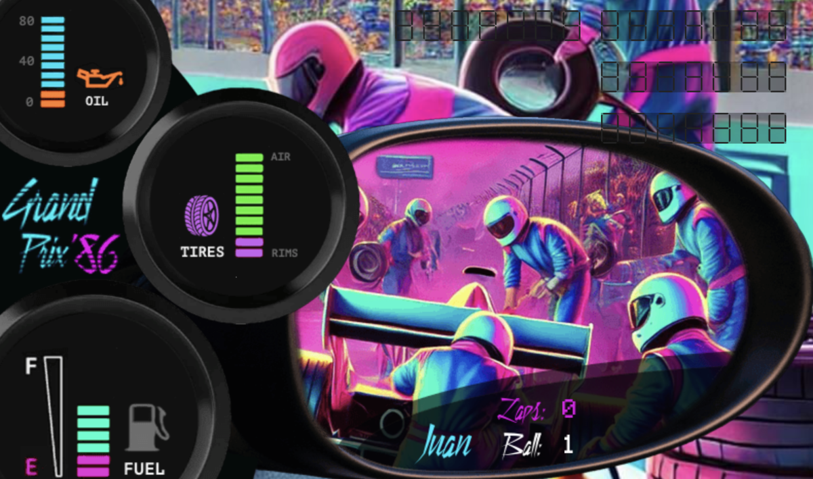
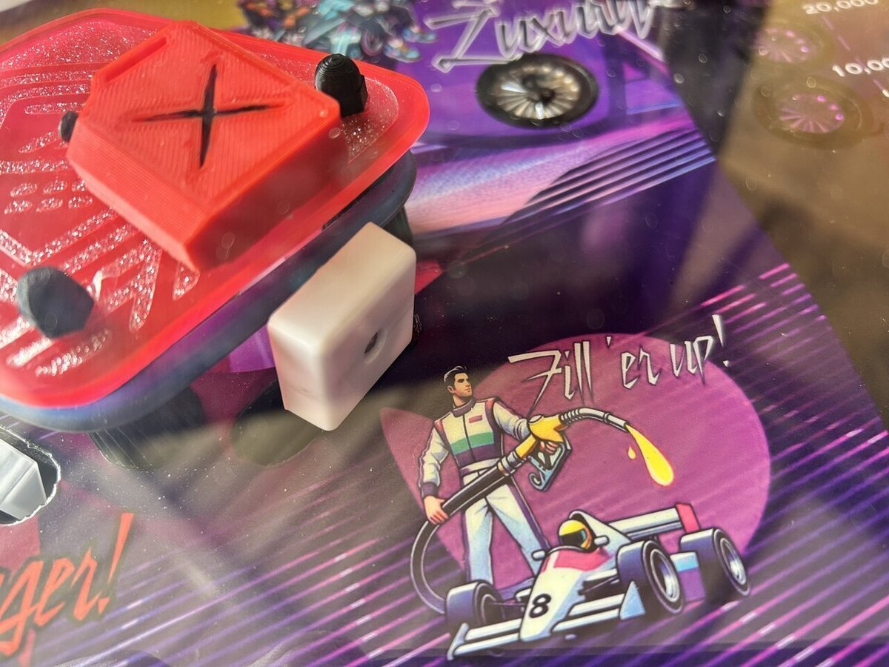
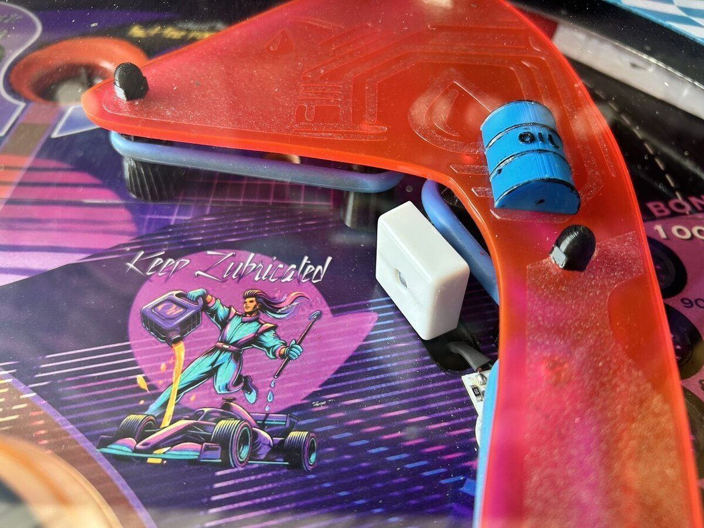
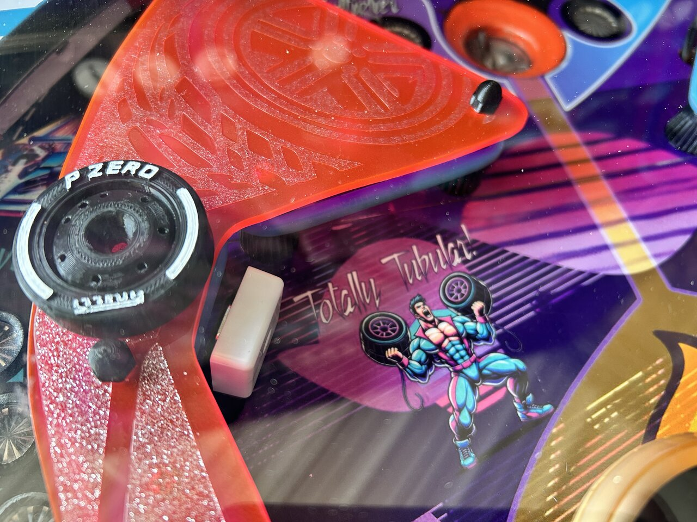

Pit Mode
========

    Updated 11/22/26 by unrared.

This is the base mode a game begins with on ball 1. Much of the default/global
config lives here.

Custom Pit Class
----------------

The file `./modes/pit/code/pit.py` contains some custom code.

When the `pit` mode starts:

1. All 4 segments are cleared.
1. The method `update_progress` is hooked into the event
   `player_pit_eternal_tick` handling the indication of state on playfield
   inserts for common patterns.
1. Sets the `name` player variable (Juan, Deuce, etc.) per the player `number`.
1. Randomly assigns the `evil_number` for the `pure_evil` mode.

`update_progress` also:

- Flashes the pit insert of each resource below full (in its level's color)
  until it's filled, and the "shoot" insert for fuel, at ball start and after
  leaving Green Flag.
- Blinks the multiball lamp in Green Flag while a multiball (other than Grand
  Prix) or Red Line is ready. (A show_player on the eternal tick replayed the
  blink every second, which could leave it steady on.)

And the engine: it starts up (`engine_start`) when the ball first reaches the
shooter lane on a turn, then crossfades (over its last 0.75s) into idling
(`engine_idle`, a loop) there until the
plunge (`engine_off`). Back in the lane later in the turn (after a ball save)
it goes straight to idling.

From the plunge it's at pace around the pit (`engine_pace`, a loop), through
Off the Line's countdown until the green flag drops (`green_flag_dropped`), and back at pace when Green Flag ends for a pit stop (through Backfire), until
the ball ends (`engine_pace_off`).

Base Functionality
------------------

- Base scoring is here from `./modes/pit/config/variable_player.yaml`.
- A pit target tops up its resource only if it's low: `event_player` posts
  `pit_fuel_filled` (lube, tires) and the level is set on that, so the fill
  sound can tell it happened. Otherwise (full, or in Green Flag) it posts
  `pit_resource_full` for the bell.
- The `ball_start` ball save lasts 10s with a2s grace period.
- Shows for the ball save, the pit arrow, swerve and fuel are from `./modes/pit/config/show_player.yaml`.

