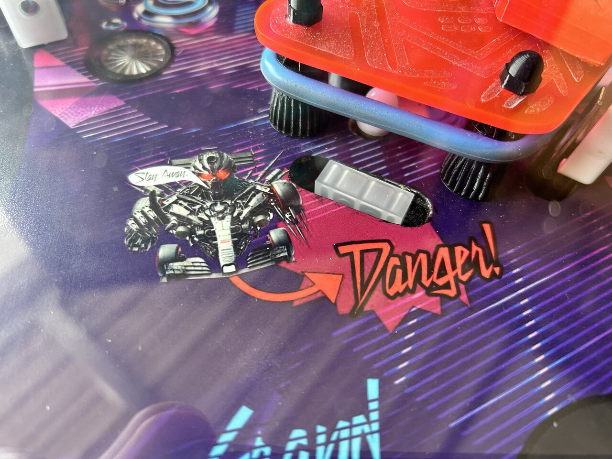

Pure Evil Mode
==============

    Updated 5/25/26 by unrared.

This mode is a random problem the player needs to deal with.

Activation
----------

The file `./modes/pit/code/pit.py` contains custom code which sets
`self.machine.game.player.evil_number` to a random number between the current
value of the player variable `lap_count` and the current `ball` times 10. So
on a player's second ball with 3 laps completed, this value will be between
3 and 20. On the `logicblock_seq_lap_complete` event, the `evil_number` is
compared to `lap_count` and on a match, the event `pure_evil_enters` is
emitted beginning the mode.

Function
--------

With the mode running, `./modes/pure_evil/config/mode.yaml` subscribes to
to the `timer_eternal_tick` event. Each second, 1% of the players current
score is removed. Also, the `pure_evil` timer in `./pit/config/timers.yaml`
starts counting down 40s to ensure the player will only need to ensure this
for a short while.

Sound and Display
-----------------

- Only the `civil_siren` loops: the `track_player` fades the `music` and
  `ambience` tracks to silence while the mode runs and back to their
  `./config/common/sound_system.yaml` volumes after (the taunts and gameplay
  sounds still play).
- 5 seconds in and then every 10 seconds (the odd 5s ticks of the mode's
  `pure_evil_taunts` timer) the `pure_evil_taunt` sound pool plays one of 6 maniacal,
  robotized taunts about taking the driver's points. Each plays once before
  any repeats. They're made by `bin/voice-callout` from
  `./misc/voice-callouts.yaml` (`pure-evil-taunt1` to `6`).
- The `pure_evil_slide` pulsates once a second (`pulsate_evil` in
  `./config/common/animations.yaml`).

Deactivation
------------

1. The `s_disqualifier` switch (drop target).
1. A ball ending via the `ball_will_end` event.
1. The `pure_evil_exits` event (currently only for dev use).
